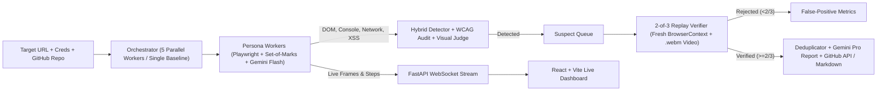

# QA Swarm — Bug Reports You Can Trust

Give QA Swarm a URL. A swarm of persona-driven Playwright agents explores your web app in parallel, a hybrid detector flags objective and visual defects, and a deterministic **2-of-3 fresh-browser replay verifier** filters out flaky noise before filing deduplicated GitHub issues (or Markdown reports) with repro steps, logs, and verification video.

## Why QA Swarm

Existing AI QA tools either depend on brittle scripted tests or emit noisy, hallucinated bug reports that waste developer time. QA Swarm requires **zero test scripts** beyond a URL and enforces a **replay verification gate**: only defects that reproduce at least **2 out of 3 times** in fresh isolated browser contexts are filed.

## Architecture



## Quick Start (Under 5 Commands)

```powershell
# 1. Python environment & Chromium
python -m venv .venv; .\.venv\Scripts\pip.exe install -r backend\requirements.txt; .\.venv\Scripts\playwright.exe install chromium

# 2. Frontend dependencies & env config
npm --prefix frontend install; Copy-Item .env.example .env  # Add GEMINI_API_KEY (and optional GITHUB_TOKEN)

# 3. Start NovaCart (seeded test target), QA Swarm API, and React Dashboard
Start-Process .\.venv\Scripts\python.exe -ArgumentList "-m uvicorn server:app --port 3100" -WorkingDirectory test-app
Start-Process .\.venv\Scripts\python.exe -ArgumentList "cli.py serve --port 8000" -WorkingDirectory backend
npm --prefix frontend run dev
```

Open **`http://127.0.0.1:5173/`** in your browser.

## Testing Your Own Repo / App

QA Swarm tests **any** locally running or deployed web app URL (`http://localhost:3000`, `http://localhost:5173`, `https://your-staging-app.vercel.app`, etc.)—NovaCart (`:3100`) is only the seeded benchmark target:

1. Start your target app locally (or copy its staging URL).
2. In the dashboard (`http://127.0.0.1:5173/`), enter your app's URL, click **GitHub & Auth**, enter your repo (`owner/repo` or `https://github.com/owner/repo`) and a `GITHUB_TOKEN` (with `repo` / `issues:write` scope, or set it in `.env`), then click **Launch Swarm**.
3. Verified bugs (`>= 2/3` fresh replays) are deduplicated, evidence media is uploaded to a `qa-swarm-evidence` branch, and GitHub issues are filed automatically (falling back to local `.md` exports if no token is provided).

Or via CLI:
```powershell
.\.venv\Scripts\python.exe backend\cli.py run-swarm --url http://localhost:3000 --github-repo owner/repo --steps 12
```

## Benchmark Results (NovaCart — 18 Seeded Bugs)

Measured with [`benchmark/run_benchmark.py`](benchmark/run_benchmark.py) at equal **75-step** total budgets (using deterministic `--mock-llm` exploratory policy; run without `--mock-llm` to benchmark live Gemini models):

| Configuration | Steps Used | Recall (vs. 18 Seeded) | False-Positive Rate | Time to First Verified Bug |
| :--- | :---: | :---: | :---: | :---: |
| Single Agent Baseline | 75 | 55.6% (10/18) | — | — |
| QA Swarm (`5 × 15`) | 75 | **77.8% (14/18)** | **0.0%** | **4.76s** |

- **Real Open-Source App Verification:** See [`docs/oss_run_report.md`](docs/oss_run_report.md) for unseeded WCAG findings verified `3/3` on `simonw/datasette`.
- **Demo Video Script:** See [`docs/demo_script.md`](docs/demo_script.md).

## Running Tests

```powershell
.\.venv\Scripts\python.exe -m pytest backend\tests -v
```
